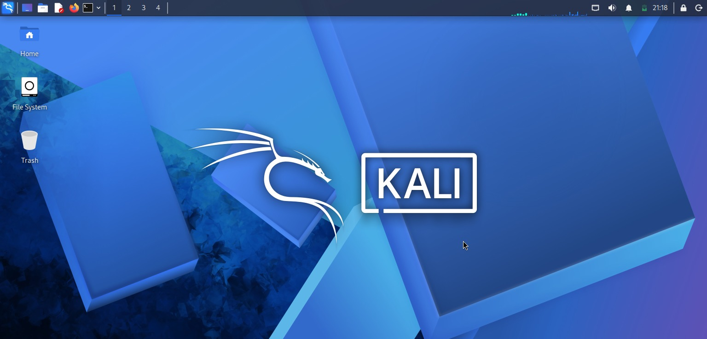
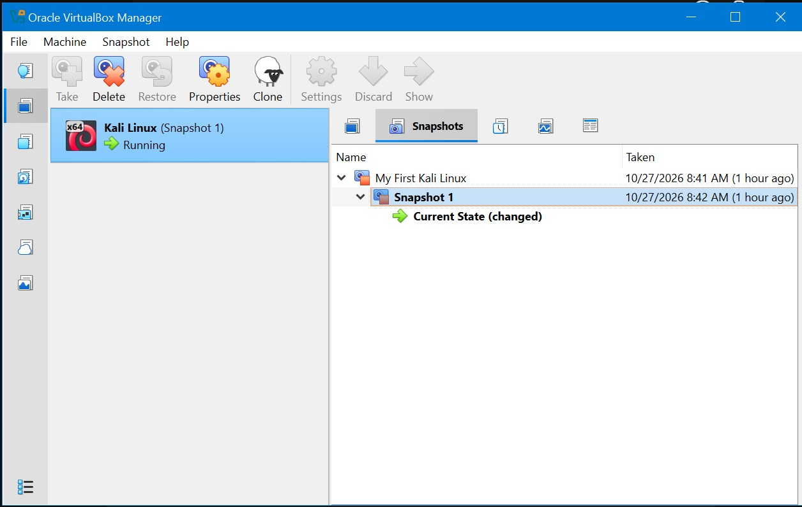

# NETWORKWALKS-Amna-B084-W1-CyberSecurity-Lab-Setup

Setting Up Kali Linux and Virtual Box for Cybersecurity Testing

---

## Overview

This project shows how I set up a safe, isolated computer lab on my laptop for learning ethical hacking.

I used **VirtualBox** to create a virtual computer running **Kali Linux**. Everything is kept inside a private virtual network so it won't affect my main computer, while still letting me connect to the internet to download tools.

---

## Objectives

* Install a virtual machine manager (VirtualBox) on my laptop.
* Unzip and import the ready-to-use Kali Linux files.
* Build a private, isolated network inside VirtualBox.
* Connect the Kali virtual computer to this private network.
* Give Kali a fixed, permanent IP address (`10.0.0.2`).
* Make sure the virtual computer can open websites and connect online.
* Take a safety backup (snapshot) so I can reset the system if anything breaks.
* Document all my steps and how I fixed any setup issues.

---

## Tools & Software

| Tool | What I Used It For |
| --- | --- |
| **7-Zip** | To extract the downloaded Kali Linux zip folder. |
| **VirtualBox** | To host and run the virtual Linux computer. |
| **Kali Linux** | The operating system used for ethical hacking and testing. |
| **Terminal / nmcli** | To control network settings inside Kali. |
| **Firefox** | To confirm the virtual machine can browse the web. |

---

## Lab Setup

### 1. Unpacking Kali Linux

I used 7-Zip to extract the compressed Kali Linux files into a folder on my laptop.

### 2. Installing VirtualBox

I installed Oracle VirtualBox, which acts as the main program to run virtual machines.

### 3. Setting Up the Private Network

Inside VirtualBox, I created a custom internal network with these rules:

* **Network Type:** NAT Network
* **Name:** `NatNetwork`
* **Address Range:** `10.0.0.0/24`

*This setting lets virtual computers talk to each other safely while still having internet access.*


### 4. Adding Kali Linux to VirtualBox

I imported Kali Linux into VirtualBox and attached its network adapter to `NatNetwork`. I also gave it 2 GB of RAM and turned on shared folders to easily send files between my laptop and Kali.




### 5. Setting a Permanent (Static) IP

Inside Kali Linux, I set a manual IP address so it never changes:

* **IP Address:** `10.0.0.2`
* **Subnet Mask:** `255.255.255.0`
* **Gateway:** `10.0.0.1`
* **DNS:** `8.8.8.8`

  

### 6. Taking a Backup Snapshot

I created a snapshot named `Clean-Baseline-State` in VirtualBox. If I break something during future hacking tests, I can restore back to this exact point instantly.



---

## Testing the Setup

I ran a few simple commands inside the Kali terminal to make sure everything works:

* **Checked my IP address:** Ran `ip addr show eth0` to confirm it was `10.0.0.2`.
* **Tested internal network:** Ran `ping 10.0.0.1` to make sure the router responded.
* **Tested internet connection:** Ran `ping 8.8.8.8` to confirm public internet access.
* **Tested web names:** Ran `dig networkwalks.com` to check if website addresses resolve.

---

## Problem I Solved

**Problem:** Internet stopped working right after assigning the static IP.

**Reason:** Kali Linux was waiting too long to verify the network connection.

**Fix:** I opened the terminal in Kali and ran:

```bash
sudo nmcli connection modify "Wired connection 1" ipv4.dad-timeout 0
sudo nmcli connection up "Wired connection 1"

```

This fixed the delay, and the internet started working again immediately.

---

## What I Learned

1. **Virtual Networks:** How to isolate virtual machines while keeping external internet access.
2. **Static IPs:** How to set up manual IP addresses in Linux instead of automatic ones.
3. **System Restores:** Why it's crucial to save clean system snapshots before running risky software.
4. **Troubleshooting:** How to fix Linux network issues using simple terminal commands.

---

## Author

* **Name:** Amna Khan
* **Batch:** B084
* **Program:** Networkwalks Cybersecurity Internship (Week 01)
* **LinkedIn:** https://www.linkedin.com/in/amna-k-1b8ba83a9/
